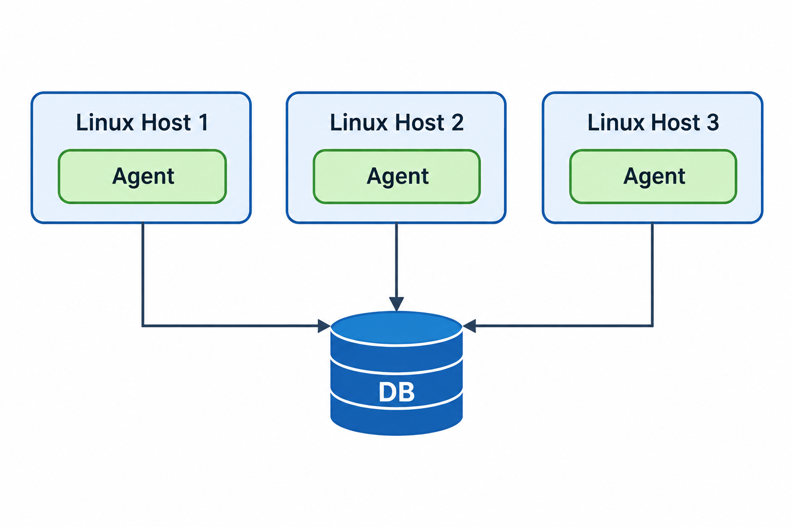

# Linux cluster monitoring agent

## Introduction
The Linux monitoring cluster agent project is a tool which will regularly capture the real time cluster usage data and save the records to the database for future reference.

## Implemenation
Discuss how you implement the project.

## Architecture

### Scripts
Shell script description and usage (use markdown code block for script usage)
- `psql_docker.sh` - Create or start the postgreSQL and the related docker instance
- `ddl.sql` - Create tables the `host_info` and `host_usage`
- `host_info.sh` - Grep and insert the hardware specs information into the table `host_info`
- `host_usage.sh` - Grep and insert the hardware usage data into the table `host_usage`
- `Crontab` - Set up the scheduled job every minute and start the Docker and PostgreSQL instances after the machine restarts

### Database Modeling
The database consists of two tables: `host_info` and host_usage.
- `host_info` - Stores static hardware and system information of the host
  - `id` - Unique identifier assigned to each host. Used as the primary key and referenced by host_usage
  - `hostname` - Hostname of the monitored machine. Used to uniquely identify each host
  - `cpu_number` - Total number of CPU cores available on the host
  - `cpu_architecture` - CPU architecture, such as x86_64
  - `cpu_model` - CPU model name identifying the processor installed on the host
  - `cpu_mhz` - CPU clock speed in MHz
  - `l2_cache` - L2 cache size of the CPU, measured in KB
  - `timestamp` - Timestamp when the host hardware information was collected
  - `total_mem` - Total physical memory available on the host, measured in MB

- `host_usage` - Stores the memory usage and statistics data 
  - `timestamp` - The execution date and time of the host resource usage capture script
  - `host_id` - Identifier of the monitored host. References host_info.id to associate usage records of the host
  - `memory_free` - Amount of free physical memory available on the host (MB)
  - `cpu_idle` - CPU idle time (%)
  - `cpu_kernel` - CPU kernel time (%)
  - `disk_io` - Number of disk I/O per second
  - `disk_available` - Amount of available disk space of the filesystem (MB)

## Test
- To test the ddl
  1. Start the docker instance or create the execute the `psql_docker.sh start <db_username> <db_password>` or `psql_docker.sh create <db_username> <db_password>`
  2. Execute the `ddl.sh`
  3. Insert some simple records into both `host_info` and `host_usage` tables
  4. Login psql client with `psql -h <db_host> -p <db_port> -U <db_username> -d <db_name>`
  5. Query the simple records

- To test the crontab
  1. Login psql client with `psql -h <db_host> -p <db_port> -U <db_username> -d <db_name>`
  2. Query the `host_usage` table

## Deployment
- Source management
  - Using GitHub to manage branches and version
  
- PostgreSQL setup
  - Using Docker to start an instance for operating the PostgreSQL
  - Set up a Docker Volume to save the data separately

- Crontab
  - Set up the automation tasks for the script without any user involvement

## Improvements
1. Append a new cronjob to restart the script if the script stops accidentally 
2. Save more statistics information in the table for troubleshooting
3. On demand report generation

